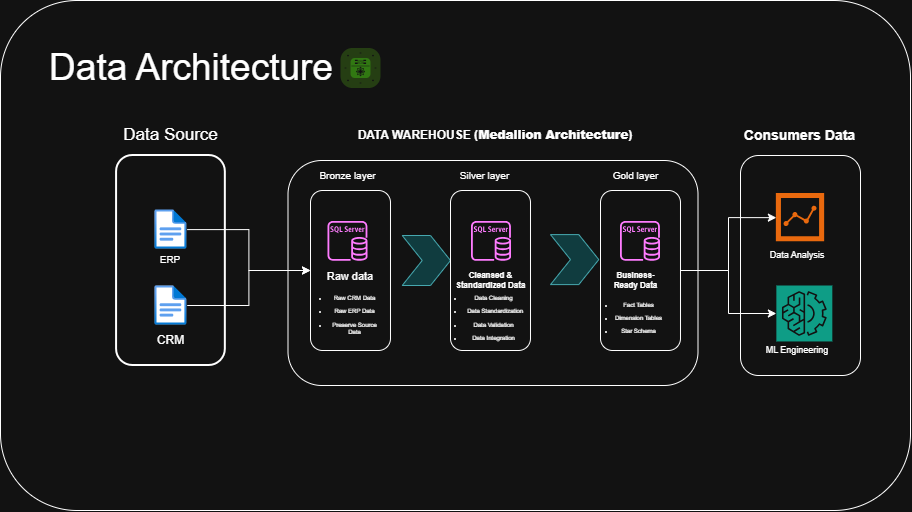
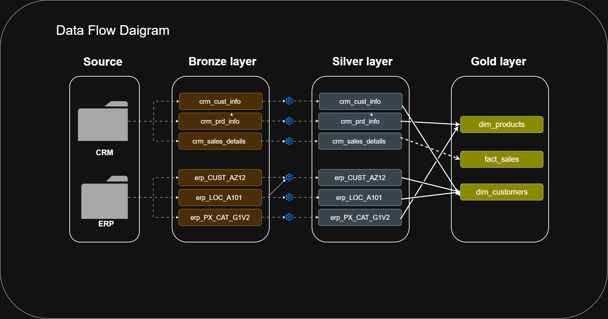

# Sql_Data_warehouse_project
this project focuses on building Data wharehouse using Microsoft sql server adn 
medallion Artcitecture Bronze,Silver and Gold layers
its integrates raw data from two sources ERP&CRM.

The data loaded into Bronze layer,cleaned and transformed in Silver layer,
and integrated into a business ready-analytical view in the Gold layer.  

## Technologies Used
- sql server 
- draw.io
## Data Architecture 



## Data Warehouse Design 



| Layer | Description | Purpose |
|---|---|---|
| Bronze | Raw Data | Stores raw data as received from source systems. |
| Silver | Cleaned Data | Cleans, validates, and transforms raw data. |
| Gold | Business-Ready Data | Contains aggregated and business-ready data for analytics. |


## Project Structure

```text
Sql_Data_Warehouse_Project/
├── dataset/
│   ├── Source_crm/
│   │   ├── cust_info
│   │   ├── prd_info
│   │   └── sales_details
│   └── Source_erp/
│       ├── CUST_AZ12
│       ├── LOC_A101
│       └── PX_CAT_G1V2
├── script/
│   ├── init_database
│   ├── Bronze_Layer/
│   ├── Silver_Layer/
│   └── Gold_Layer/
├── docs/
│   ├── Data_Architecture.png
│   └── Data_Flowchart.png
├── test/
│   ├── check_Bronze_layer.sql
│   └── check_Silver_layer.sql
└── README.md
```
## How to Run

1. Clone this repository.
2. Open SQL Server Management Studio (SSMS).
3. Execute `init_database.sql` to create the database.
4. Execute the SQL scripts in the following order:
   - Bronze Layer
   - Silver Layer
   - Gold Layer
5. Run the validation scripts in the `test` directory.

